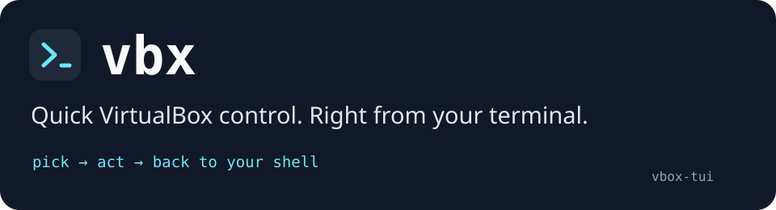

<p align="center"></p>
<p align="center">
  <a href="https://github.com/aditya-shrivastavv/vbox-tui/actions/workflows/ci.yml"></a>
  <a href="LICENSE"></a>
  
  
</p>
<p align="center"><strong>Pick a VM. Run an action. Get back to work.</strong></p>
<p align="center"><a href="#install">Install</a> · <a href="#quick-start">Quick start</a> · <a href="#commands">Commands</a> · <a href="docs/USAGE.md">Usage guide</a> · <a href="CONTRIBUTING.md">Contribute</a></p>

**vbox-tui**, invoked as **`vbx`**, puts everyday VirtualBox actions in a small interactive prompt. Start a lab, pause a guest, or connect over SSH without opening the GUI or remembering `VBoxManage` syntax. The prompt runs inline and returns to your shell after the task.

```text
$ vbx
? Select a virtual machine
>  dev-linux       Stopped
   test-windows    Running
   sandbox         Saved

? dev-linux — choose an action
> Start headless
  Start and SSH

+ Started "dev-linux" in headless mode.
$
```

*Illustrative interaction; available actions depend on the VM's state.*

## Features

- **Quick lifecycle actions:** headless start, pause, resume, graceful shutdown, and save state.
- **SSH that remembers:** configure an alias or host/port/username once; edit it whenever you need.
- **Batch operations:** mark machines with Space or name several on the command line.
- **Guest restart:** request a graceful reboot through a configured guest route.
- **Snapshots:** browse a tree, create snapshots, and restore through an explicit confirmation flow.
- **Rename:** change a powered-off VM's name while retaining settings by UUID.
- **Offline demo:** explore the prompts with fake machines and in-memory settings.

## Install

### Requirements

- **Windows** is the primary supported host. Other platforms are not currently claimed as verified.
- **Oracle VirtualBox**, with VMs already registered under your user account.
- **OpenSSH client** for SSH features; other actions do not need it.
- **Go 1.25+** when building from source.

### Download for Windows

Download `vbx-windows-amd64.zip` from the [latest release](https://github.com/aditya-shrivastavv/vbox-tui/releases/latest), extract it, and run `vbx.exe` from PowerShell. Windows x64 is the released binary target. Go is not required for the downloaded executable.

Each release includes `checksums.txt`. Verify the downloaded archive against it:

```powershell
Get-FileHash .\vbx-windows-amd64.zip -Algorithm SHA256
```

The executable is unsigned; checksums detect a mismatched download but do not replace publisher signature verification.

### Build from source

```powershell
git clone https://github.com/aditya-shrivastavv/vbox-tui.git
cd vbox-tui
go build -trimpath -o dist/vbx.exe ./cmd/vbx
.\dist\vbx.exe --help
```

Run the executable directly, or put it in a directory already on your `PATH`. Check `Get-Command vbx -All` before installing it under that name: other tools may use it too. This project does not install shell aliases or change your profile.

For development builds of a particular revision, inspect the [Windows CI artifacts](https://github.com/aditya-shrivastavv/vbox-tui/actions/workflows/ci.yml). There is no package-manager installation documented yet.

## Quick start

Try the experience without VirtualBox or real VM operations:

```powershell
.\dist\vbx.exe --demo
```

For real machines:

```powershell
.\dist\vbx.exe
```

After adding the executable to `PATH`, use `vbx` directly. Navigate with arrows, type to filter, and press Enter. Space marks several machines for a batch; Escape goes back or cancels the current prompt.

## Commands

| Command | Purpose |
| --- | --- |
| `vbx` | Pick machines and an action |
| `vbx start "dev-linux"` | Start headless or restore saved state |
| `vbx pause "dev-linux"` | Pause execution |
| `vbx resume "dev-linux"` | Resume a paused VM |
| `vbx stop "dev-linux"` | Request graceful ACPI shutdown |
| `vbx save "dev-linux"` | Save the guest's current state |
| `vbx restart "dev-linux"` | Request a graceful guest reboot |
| `vbx ssh "dev-linux"` | Start/resume if needed, then connect |
| `vbx config "dev-linux"` | Edit SSH and restart settings |
| `vbx config --path` | Locate the saved configuration |
| `vbx rename "dev-linux" "dev-blue"` | Rename a powered-off VM |
| `vbx snapshots "dev-linux"` | Browse one VM's snapshot tree |

Omit the VM name for a picker. Names match exactly; use a UUID to disambiguate duplicate names. SSH, settings, rename, and snapshots are single-machine workflows.

```powershell
vbx start "dev-linux" "test-windows"
vbx --help
```

Batch actions run sequentially. A failed operation stops remaining work; the summary distinguishes completed, failed, skipped, and unattempted targets. See the [usage guide](docs/USAGE.md) for cancellation and exit behavior.

## SSH setup

First use asks for an **SSH alias** or an explicit **host, port, and username**. For a localhost NAT forward, that could be `127.0.0.1`, port `2222`, and the guest's login name.

```powershell
vbx ssh "dev-linux"
vbx config "dev-linux"    # edit or reset saved values later
```

Authentication and host-key prompts belong to your OpenSSH client. `vbx` stores connection settings, not passwords. When the SSH session ends, you return to the shell.

Settings retain the `vbox-tui` directory and are keyed by VM UUID. On Windows the default is `%APPDATA%\vbox-tui\config.json`. Use `vbx config --path` for your actual location, or `--config PATH` for an explicit file. See [configuration and recovery](docs/USAGE.md#configuration).

## Behavior to know

- `stop` sends a shutdown request; a guest that ignores ACPI may remain running. There is no automatic forced power-off.
- SSH restart currently needs noninteractive authentication and sufficient reboot privileges; normal interactive SSH still supports passwords. Configure the guest OS and restart route in `vbx config`.
- Snapshot creation/restoration is available through `vbx` → VM → **Snapshots**. Restore requires an eligible stopped VM and can create a protective snapshot first. Snapshots remain tied to VirtualBox storage and are not independent backups.
- Rename changes the VM's name, not its identity. SSH/restart settings follow its UUID.
- VMs are created and their hardware/networking configured in VirtualBox. `vbx` handles quick actions afterward.

## Development

```powershell
go vet ./...
go test ./...
go build -trimpath -o dist/vbx.exe ./cmd/vbx
```

Tests use fakes and fixtures. Real VM mutations require explicit authorization during development. Start with [CONTRIBUTING.md](CONTRIBUTING.md), [the architecture map](docs/ARCHITECTURE.md), and [AGENTS.md](AGENTS.md).

The repository includes a reusable [Bubble Tea development skill](.agents/skills/bubbletea-development/SKILL.md) for future terminal tools.

## Community and security

Report reproducible bugs and suggest focused improvements through [GitHub Issues](https://github.com/aditya-shrivastavv/vbox-tui/issues). For vulnerabilities, follow [SECURITY.md](SECURITY.md); do not post credentials or sensitive VM details in a public issue.

## License

[MIT](LICENSE). Built with [Bubble Tea](https://github.com/charmbracelet/bubbletea), [Bubbles](https://github.com/charmbracelet/bubbles), and [Lip Gloss](https://github.com/charmbracelet/lipgloss).

An independent project, unaffiliated with or endorsed by Oracle. VirtualBox is a trademark of Oracle.
